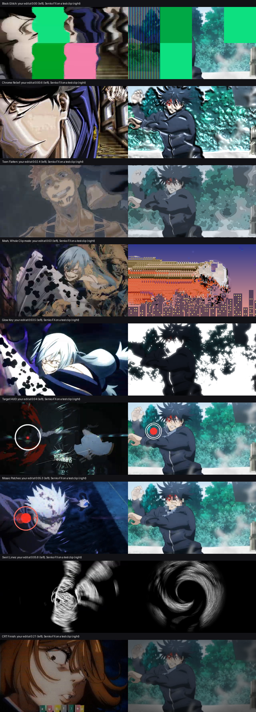
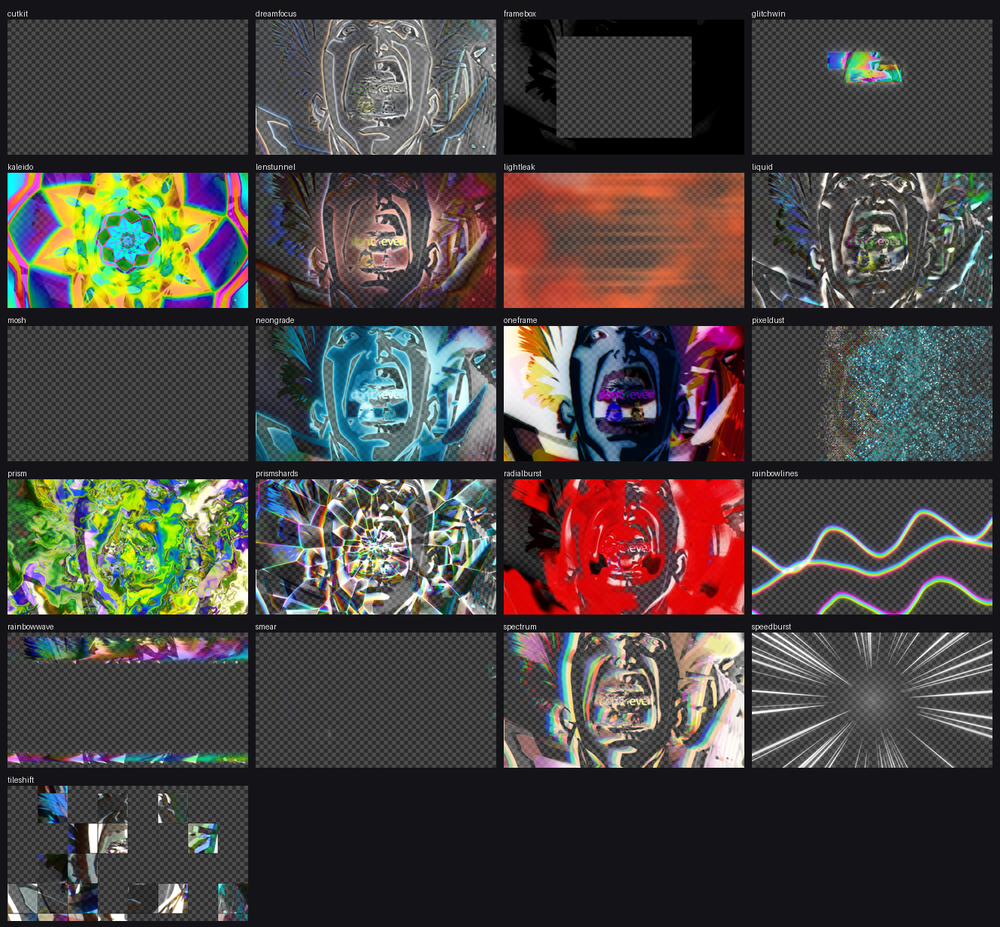
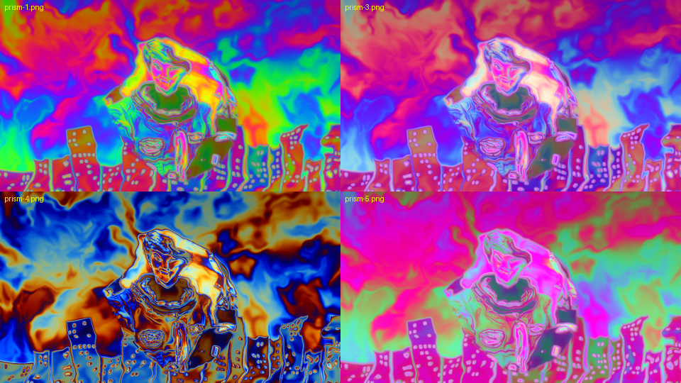
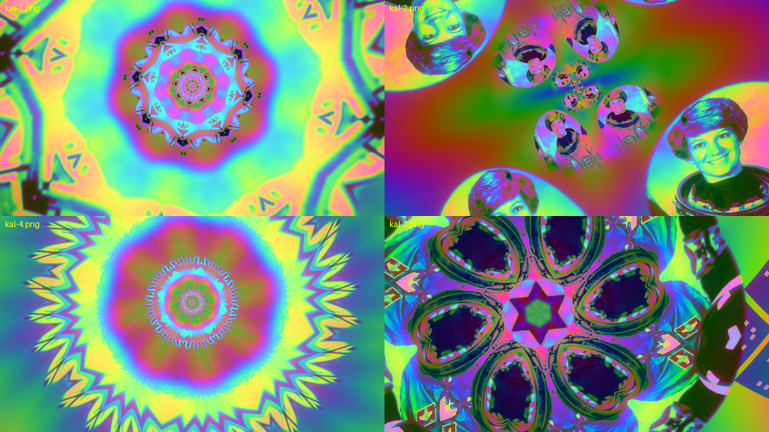
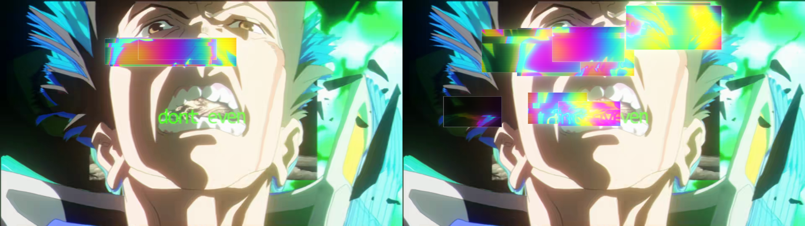
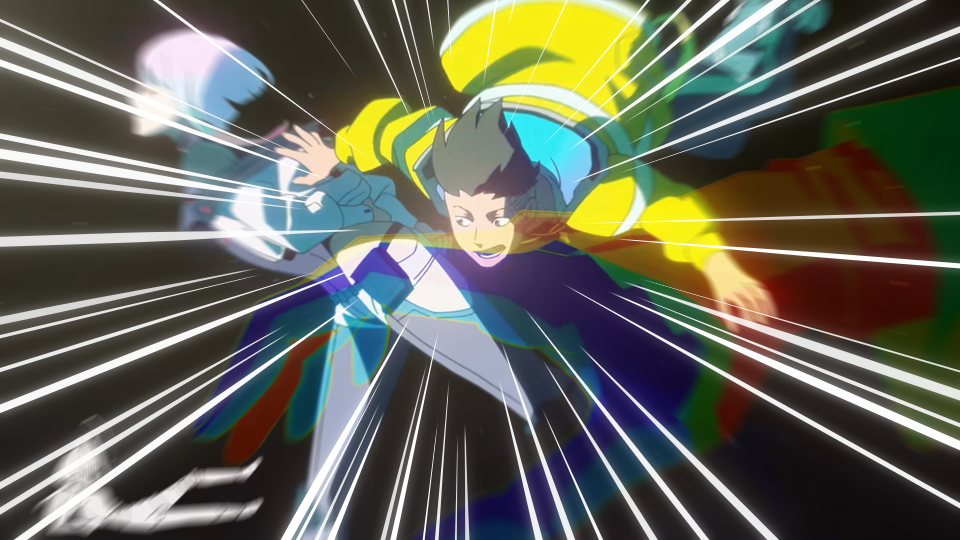
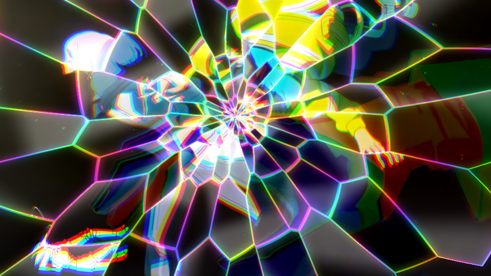
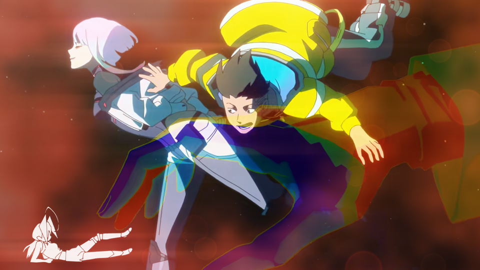

# Senko FX

29 native After Effects effects for edits: trippy colour, glitch, datamosh, smears, transitions and one-frame beat hits. Every effect has a Preset menu and an Output switch (Full Picture or Effect Only, see-through for transitions).

## Download

Get **SenkoFX-Setup-1.7.1.zip** from the [latest release](https://github.com/yur0fx/SenkoFX/releases/latest).

1. Close After Effects.
2. Unzip, run `SenkoFX-Setup-1.7.1.exe` (asks for admin because Adobe's shared plug-in folder is in Program Files).
3. Open After Effects and look under **Effect > Senko FX**.

Windows x64, any After Effects version that loads `Common\Plug-ins\7.0\MediaCore`. CPU only, so it runs on any GPU or none. 8, 16 and 32 bpc, multi-frame rendering.

**Auto update:** from 1.7.1 on, Senko FX keeps itself up to date. A Windows scheduled task ("Senko FX Updater") checks this repo's latest release at logon and every 3 hours, and installs a newer version in the background while After Effects is closed. To turn it off, set the DWORD `AutoUpdate` to `0` under `HKLM\Software\Senko FX`, or disable the task in Task Scheduler.

Manual install: copy the .aex files from `SenkoFX-plugins-1.7.1.zip` to `C:\Program Files\Adobe\Common\Plug-ins\7.0\MediaCore\Senko FX`.

## Effects

| Effect | What it does | Key controls |
|---|---|---|
| Senko Prism Flow | Liquid psychedelic swirl (domain-warped flow) that re-paints the clip in cycling holographic colour, rainbow split on the warps, neon edges, glow. Animates by itself | Palette (Holographic, Acid, Vaporwave, Oil Slick, Candy Neon, Clip Colours), Warp, Swirl Size, Flow Speed, Colour Bands, Colour Cycle Speed, Keep Shapes, Rainbow Split, Neon Edges, Glow |
| Senko Kaleido | Kaleidoscope mirrors with an endless zoom tunnel; Spin turns the tube so the pattern keeps changing; rainbow rings ride outward | Mode (Kaleidoscope, Mirror Tiles, Spiral, Fractal Bloom), Segments, Centre (what gets mirrored), Spin, Zoom, Tunnel + Tunnel Speed, Twist, Psychedelic Colour, Rainbow Rings, Glow |
| Senko Smear | Reads the layer's own motion. Streak (brushed smear behind the subject), Multiples (repeated copies), Afterimage (tinted echoes) | Mode, Smear Length, Brush Lines, Copies, Tint, Trail Glow, Skip Held Frames (works on twos/threes), Show Motion (debug) |
| Senko Cut Kit | 12 transitions on one Progress slider: Slice, Zoom Warp, RGB Tear, Pixel Stretch, Ink Bleed, Shards, Spin, Block Glitch, Iris Ring, Whip, Pixelate, Burn | Style, Progress (keyframe 0 -> 100), Transition In, Direction, Centre, Pieces, Edge Colour/Glow, Motion Blur |
| Senko Mosh | Datamosh with no re-encoding. Melt Cuts finds cuts by itself and pushes the old shot with the new shot's motion, healing in patches; Bloom repeats one moment's motion; Whole Clip (new in 1.7) is a regular datamosh on any clip, no cut needed | Mode, Mosh Length, Key Offset, Cut Sensitivity, Block Size, Recovery, Push, Block Glitches, Colour Smear |
| Senko One Framer | Single-frame hits for the beat: Invert, Flash White, Colour Flash, RGB Jolt, Zoom Punch, Shake Jolt, Red Negative, Posterize Pop, Mirror Flip, Glitch Slices, Blow Out, Neon Edges, Hue Shift (1.5), or Random Each Hit; Extra Kick adds a zoom + colour split on top | Hit Look, Strength, Fire (whole layer = put it on a 1-frame adjustment layer; Every N Frames; Random Hits), Hit Length, Colour, Amount, Direction |
| Senko Glitch Window | Glowing glitch boxes over a spot (eyes, face): each box shows a displaced, zoomed, over-exposed copy of what is under it, with RGB split, scanlines, outline, glow; re-rolls every N frames | Look (Rainbow Burn, Acid Green, Inverted, Posterize, Thermal, Clean Copy), Centre, Windows, Width/Height, Spread, Displace, Zoom In, RGB Split, Scanlines, Outline, Glow, Re-glitch Every |
| Senko Pixel Dust | The layer breaks into dithered pixels that peel off and drift away as glowing dots, with a crunchy 8-bit band at the edge. Keyframe Dissolve 0 -> 100 | Dissolve, Direction, Pixel Size, Pixel Band, Drift, Swirl, Shrink, Extra Sparkle, Dot Colour (Keep, Cyan Pop, Hot Pink, Rainbow, Custom), Colour Levels, Dither, Glow |
| Senko Spectrum Echo | Colour-tinted offset copies of the layer (RGB, rainbow, pink/cyan...). Cut-out layers get them behind; full-frame clips get a crisp colour split | Copies, Offset, Direction, Fan Out, Blend (Auto, Behind Layer, Colour Split, Screen, Add), Colours, Copy Look, Opacity, Fade Out, Scale Step, Wobble, Glitch Jitter, Glow |
| Senko Rainbow Wave | VHS wave bands that bend the picture sideways, split RGB, smear the highlights and tint them with a travelling rainbow. Animates by itself | Amount, Waves, Speed, Direction, Coverage, Band Size, Tape Jitter, Rainbow, RGB Split, Smear, Scanlines, Glow |
| Senko Neon Grade | One-click neon tritone grades with coloured bloom, halation, grain and vignette | Palette (Cyber Cyan, Toxic Green, Hot Magenta, Blood Red, Ultraviolet, Sunset, Custom), Contrast, Balance, Keep Original Colour, Glow, Glow Size, Glow Threshold, Halation, Grain, Vignette |
| Senko Liquid Chrome | The picture melts into slow glossy liquid: shapes go blobby, a moving warp folds them, light catches wet highlights and bright rims | Melt, Blob Size, Flow Speed, Gooeyness, Gloss, Shine Sharpness, Light Angle, Bright Rims, Depth, Colour (Keep, Silver Chrome, Ice Blue, Purple Haze, Oil Slick, Red Liquid, Gold), Colour Bands, Keep Detail, Glow |
| Senko Frame Box | The clip sits in a box (4:3, square, 9:16, cinema, same as layer, circle) that pops and springs on the beat, over black / blurred copy / colour / nothing | Shape, Box Size, Position, Round Corners, Content (Crop, Whole Frame), Content Zoom, Pop (keyframe), Auto Pulse Every N frames, Pulse Size, Springiness, Shake, Background, Edge Softness, Border + Border Glow |
| Senko Radial Burst | Zoom-blur tunnel from a centre with rings rippling out, crushed into a hard duotone (blood red on black by default) with grain and glow | Centre, Zoom Blur, Spin Blur, Clear Centre, Ring Distort/Size/Speed, Look (Blood Red, Keep Colour, Black and White, Ink Blue, Toxic, Custom), Threshold, Hardness, Grain, Glow |
| Senko Dream Focus | Soft dreamy focus for blur-in / blur-out moments, with an optional sharp spot so eyes stay crisp, blooming highlights, colour fringe, haze | Blur (keyframe for blur in/out), Blur Type (Soft Lens, Directional, Zoom), Direction, Sharp Spot Size/Centre/Softness, Bloom, Bloom Threshold, Colour Fringe, Haze + colour, Saturation |
| Senko Rainbow Lines | Thin glowing ribbons of rainbow strands that wiggle and slide across, over or behind the subject | Ribbons, Strands per Ribbon, Spacing, Thickness, Direction, Wave Height/Length, Wiggle, Speed, Line Length, Slide Speed, Colours, Glow, Blend (Screen Over, Behind Layer, Lines Only) |
| Senko Lens Tunnel | Old-lens dream look: sharp centre, edges smeared outward with colour fringe, lens bulge, red halation round highlights, bloom, vignette, grain | Centre, Sharp Area, Edge Smear, Lens Bulge, Colour Fringe, Halation + colour, Bloom, Vignette, Vignette Roundness, Grain |
| Senko Speed Burst | Anime focus lines shooting from a point (re-roll every few frames), centre flash, zoom blur | Centre, Lines, Density, Thickness, Clear Centre, Taper, Re-roll Every, Line Colour(s), Centre Flash, Zoom Blur, Glow, Blend |
| Senko Light Leak | Drifting film-burn leaks from the edges, anamorphic flare streaks pulled from highlights, soft bokeh orbs | Leak, Leak Colours (Red Burn, Pink Sunset, Gold, Cyan Pink, Rainbow, Custom), Leak Size, Drift Speed, From, Burn Out, Flicker, Streaks / Length / Threshold / Colour, Bokeh / Size / Count |
| Senko Prism Shards | The picture cracks into glass: shards refract shifted, zoomed, tilted copies with colour split, facet shine and rainbow edges; can explode outward | Crack Pattern (Impact from Centre, Crystal Cells), Shard Size, Centre, Coverage, Explode (keyframe), Refraction, Zoom Spread, Twist, Colour Split, Facet Shine, Edge Light / Width, Rainbow Edges, Glow, Re-crack Every |
| Senko Tile Shift | The picture breaks into square tiles that slide, zoom, flip, flash and drop out, re-rolling every few frames, with gaps and glowing outlines | Tile Size, Tile Shape, Tiles Affected, Re-roll Every, Shift, Zoom Spread, Flip Chance, Dropout, Brightness / Colour Jumps, Gaps + colour, Tile Outline, Glow |
| Senko Block Glitch (new in 1.7) | Big screen-glitch cells: some cells flash a flat neon colour, some turn into RGB LCD stripes, some go wavy; Grid Slice mode slides row bands sideways, drains the colour except reds and draws a thin grid (0:00 and 0:04.6 of the edit) | Mode (Colour Blocks, Grid Slice), Columns, Rows, Cells Affected, Solid / Stripe / Wavy mix, Re-roll Every, Stripe Width, Stripes Everywhere, Wave Amount, Darken, Grid Lines, Row Slide, Keep Reds |
| Senko Chrome Relief (new in 1.7) | The picture turns into embossed chrome: brightness becomes height, lit with shine, dark creases and a sharpened edge, optional sideways wave (0:00.3-0:01) | Depth, Relief Size, Light Angle, Shine, Creases, Sharpen, Refraction, Wave |
| Senko Toon Flatten (new in 1.7) | Flat cartoon posterize: smooths the shading into a few flat steps with soft step lines and slightly washed colour, keeps the original ink lines, optional melt (0:02-0:03) | Smoothness, Steps, Step Softness, Lines, Keep Line Art, Saturation, Tint, Melt |
| Senko Glow Key (new in 1.7) | Bright parts become a flat glowing key colour with ragged edges, the rest goes dark and tinted; Invert swaps them (0:03.5) | Threshold, Softness, Key Colour, Glow + Size, Darken Rest, Rest Tint, Ragged Edges, Invert |
| Senko Target HUD (new in 1.7) | Lock-on markers: double ring with red dot, pink ring, capsule marker with linked circles, target circles, or a strip of icon cards. Pops in with overshoot, RGB split, jitter, wobble (0:04-0:08.5) | Style, Centre, Size, Angle, Pop (keyframe), Colours, Line Thickness, Dot Size, Cards, Jitter, Wobble, RGB Split, Re-roll Every, Glow, Blend (Over Clip, HUD Only) |
| Senko Mosaic Patches (new in 1.7) | Random square patches round a spot (a face) turn into big pixels or slide out of place, re-rolling every few frames, with an optional scan streak (0:05.3) | Centre, Area Size, Patch Size, Pixel Size, Patches, Patch Shift, Re-roll Every, Scan Streak + colour |
| Senko Swirl Lines (new in 1.7) | The picture is twisted round a point and redrawn as white contour lines on black with a spin blur, fading out away from the centre (0:05.8) | Centre, Twist, Twist Radius, Line Count, Line Width, Line Threshold, Spin Blur, Line / Background Colour, Fade Outside, Keep Picture |
| Senko CRT Finish (new in 1.7) | "Played back on an old screen" pass: shadow-mask dot grid (or scanlines, or RGB stripes) over a darker, washed picture with colour bleed, softness, noise, flicker, vignette (0:19 to the end) | Screen Pattern, Pattern Size / Strength, Darken, Faded Blacks, Saturation, Colour Bleed, Softness, Noise, Flicker, Vignette |

Tips: Mosh Melt Cuts needs a precomp that holds both clips (it looks for the cut inside the layer). Mosh Whole Clip works on a single clip: it drops a keyframe every Mosh Length frames (Key Offset moves where) and smears the frozen picture with the motion of every frame after it. Smear and Mosh read other frames of the layer, so precompose first if the layer has time-remapping or effects you want smeared.

## Looks

| | |
|---|---|
|  |  |
|  |  |
|  |  |

## What's new in 1.7.1

- Senko FX now updates itself. Install 1.7.1 once and new versions arrive automatically.

## What's new in 1.7.0

- Eight new effects matched frame by frame to an anime edit: Block Glitch, Chrome Relief, Toon Flatten, Glow Key, Target HUD, Mosaic Patches, Swirl Lines and CRT Finish, with 7 presets each.
- Senko Mosh has a new Whole Clip mode: a regular datamosh on any clip, no cut needed (presets Whole Clip Mosh and Whole Clip Smear).

## Earlier (1.6.5)

- Output control at the bottom of every effect: Full Picture or Effect Only (see-through), for transitions.
- Fixes the "checkout id" error when applying an effect (1.6.2).
- Mosh and Smear no longer just shift the picture sideways (1.6.3).
- Centre / Position controls draw where the crosshair is (1.6.4).

Made for the [Senko](https://github.com/yur0fx/Senko) After Effects extension.
