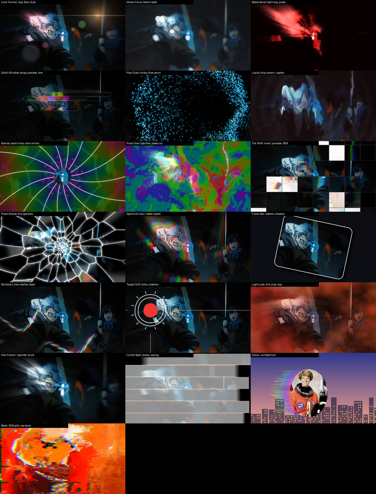

## Senko FX 1.8.0: more control, cleaner looks

Every one of the 29 effects got new controls, and every control was tested at its limits. If you have 1.7.1, this installs by itself in the background while After Effects is closed.

**New on every effect** (groups at the bottom):
- **Finish**: Effect Opacity, Blend With Original (12 modes), Exposure, Contrast, Saturation, Hue Shift, Tint, Extra Glow.
- **Limit Effect To**: circle, box, linear wipe, bright parts, dark parts or layer alpha, with feather, angle and invert.
- **Timing**: Animate On twos / threes / fours, strobe, random flicker.
- Controls that do nothing in the current mode grey out.

**New inside the effects**, a few highlights:
- Light rays, lens flares, real bokeh balls, sparkles and film dust (Lens Tunnel, Dream Focus, Radial Burst, Prism Flow, Prism Shards, Light Leak, One Framer).
- Pulse on the beat (Radial Burst, Kaleido, Spectrum Echo, Target HUD, Light Leak).
- New shapes and styles: Glitch Window strips and bars, Pixel Dust circles / stars and dissolve from a point, Rainbow Lines dashes and taper, Frame Box rotation and drop shadow, Target HUD ticks, radar sweep and crosshair.
- Cut Kit easing (snap, overshoot), flash and shake; Mosh RGB split and row tears; Smear rainbow trails.

**Cleaner looks**: no banding in glows and gradients at 8 bpc, a three-layer lens glow, deep blacks under Prism Flow and Kaleido colour.

**Fixes**: Smear tint colours, faint Liquid Chrome rims, Light Leak streaks on dark footage, Radial Burst glow on Blood Red.

Old projects open unchanged.



### Install
1. Close After Effects.
2. Unzip **SenkoFX-Setup-1.8.0.zip** and run `SenkoFX-Setup-1.8.0.exe` (it asks for admin). It installs over older versions.
3. Open After Effects and look under **Effect > Senko FX**.

Manual install: copy the .aex files from `SenkoFX-plugins-1.8.0.zip` to `C:\Program Files\Adobe\Common\Plug-ins\7.0\MediaCore\Senko FX` (no auto update that way).

Windows x64, CPU only (runs on any GPU or none), 8/16/32 bpc.

SHA-256:
```
62a49be570ecb783232ebf435478b5fe4e8a94ddc21f8549003716a9242ed4ba  SenkoFX-Setup-1.8.0.zip
4e00a44f6ca21454a94ff1307e565766a0d94129874753fb65d701a3b7aa50ec  SenkoFX-plugins-1.8.0.zip
```
