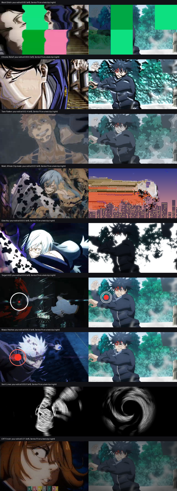

## Senko FX 1.7.0: eight new effects and a Whole Clip datamosh (29 effects in total)

New effects, matched frame by frame to an anime edit:

- **Senko Block Glitch**: big screen-glitch cells that flash neon colours, turn into RGB LCD stripes or go wavy. Grid Slice mode slides row bands sideways, drains the colour except reds and draws a thin grid.
- **Senko Chrome Relief**: the picture turns into embossed chrome, with shine, dark creases, a sharpened edge and an optional sideways wave.
- **Senko Toon Flatten**: flat cartoon posterize. Shading becomes a few flat steps, and the original ink lines are kept.
- **Senko Glow Key**: bright parts become a flat glowing key colour with ragged edges while the rest goes dark. Invert swaps them.
- **Senko Target HUD**: lock-on markers (double ring with a red dot, pink ring, capsule marker with linked circles, target circles, or a strip of icon cards) that pop in with overshoot, RGB split, jitter and wobble.
- **Senko Mosaic Patches**: random square patches round a spot, like a face, turn into big pixels or slide out of place, re-rolling every few frames.
- **Senko Swirl Lines**: the picture twists round a point and is redrawn as white contour lines on black with a spin blur.
- **Senko CRT Finish**: the "played back on an old screen" look, with a shadow-mask dot grid, scanlines or RGB stripes, washed colour, bleed, noise, flicker and vignette.

**Senko Mosh** has a new **Whole Clip** mode: a regular datamosh on any single clip, no cut needed. It drops a keyframe every Mosh Length frames and smears the frozen picture with the motion of every frame after it. Use the Whole Clip Mosh or Whole Clip Smear preset.



### Install
1. Close After Effects.
2. Unzip **SenkoFX-Setup-1.7.0.zip** and run `SenkoFX-Setup-1.7.0.exe` (it asks for admin). It installs over 1.6.5.
3. Open After Effects and look under **Effect > Senko FX**.

Manual install: copy the .aex files from `SenkoFX-plugins-1.7.0.zip` to `C:\Program Files\Adobe\Common\Plug-ins\7.0\MediaCore\Senko FX`.

Windows x64, CPU only (runs on any GPU or none), 8/16/32 bpc.

SHA-256:
```
3474b0f3e4293bae4ebc21eb2df3dfe8dbfd744f6f751bbaa34846af7e4fb642  SenkoFX-Setup-1.7.0.zip
5509cb18f76bf42f46934ddc229a0646364e3d44f217ed55662103ec4a0e4332  SenkoFX-plugins-1.7.0.zip
```
