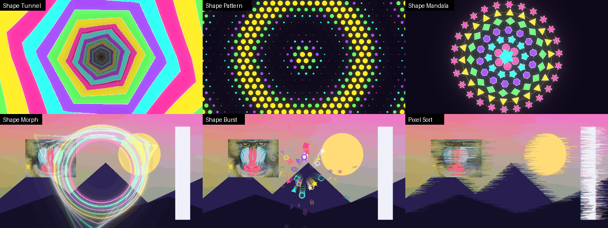
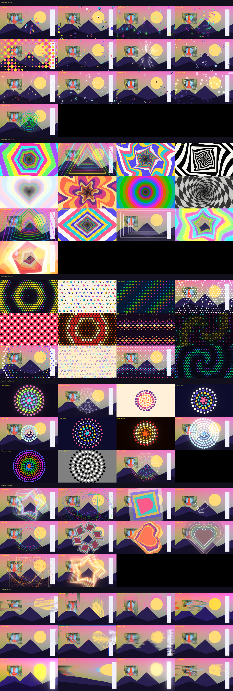

## Senko FX 1.13.0: abstract shape effects

- **Senko Shape Tunnel**: an endless tunnel of nested shapes zooming at you. Circle, triangle, square, diamond, pentagon, hexagon, octagon, star, 4-point star, cross, heart, flower, or a morph between two. Solid bands, lines, bands + lines, glow lines or checker; twist, spin, wide stretch, wobble, beat punch, depth fade and a see-through centre. 13 presets (Hex Warp Drive, Neon Triangles, Star Spiral, Square Hypno, Heart Tunnel, Flower Bloom, Rainbow Circles, Checker Vortex, Morphing Portal, Beat Diamonds, Wide Speed Tunnel, Portal Window, Fire Ring Flow).
- **Senko Shape Pattern**: a moving wallpaper of shapes on a square, hex, brick or diamond grid. Ripple, sweep, twinkle, spiral or beat waves grow, shrink and turn them; every other shape can differ, neighbours spin opposite, the grid scrolls; Memphis hard shadows; colour by checker, rows, columns, diagonal, random, wave or distance; own background. 12 presets.
- **Senko Shape Mandala**: rings of shapes around a centre, kaleidoscope style. Shapes per ring, more per ring, a different shape each ring, rings turn opposite, shapes point outward, breathe, beat punch, centre shape, guide circles and spokes. 11 presets.
- **Senko Shape Morph**: one big shape morphing A > B > C on a timer (or by hand), with echo copies trailing behind (delay, size step, turn step), outline / glow line / filled styles, draw-on and moving dashes, copies around the centre, liquid wobble and beat punch. 10 presets.
- **Senko Shape Burst**: shapes for MMV and motion backgrounds: burst on beat, float, rain, rise, orbit, pulse grid, confetti pop; filled or outlined, Memphis shadows, trails, glow. 13 presets.
- **Senko Pixel Sort**: glitch-art pixel sorting at any angle. Runs from bright parts, dark parts, a range, edges, random or whole lines; sort by brightness, hue, saturation or a channel; Sort, Smear, Stretch or Shuffle; animate Sort Amount for a growing reveal; re-roll, colour split, glow. 12 presets.
- All shape effects have palettes (Memphis, Neon, Pastel, Fire, Ice, Sunset, White, Black & White, Picture, Two Colours, Rainbow), glow and Blend: Shapes Only (see-through), Over Layer, Add, Screen, Behind Layer.
- Fast by default, no quality setting: about 30-140 ms per 1080p frame on a 4-core CPU (offline bench). Glow is quicker in every effect that has it (same look, checked pixel for pixel).

The other 40 effects are unchanged (rebuilt at 1.13.0). Untested in real After Effects yet.

