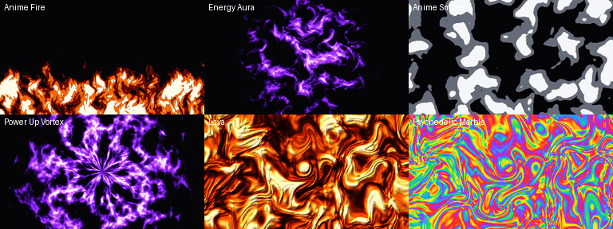

## Senko FX 1.12.0: Senko Fractal Noise

- **Senko Fractal Noise**: a better Fractal Noise, made for edits. 28 presets: Classic (AE look), Anime Smoke, Soft Clouds, Storm Clouds, Anime Fire, Inferno, Blue Flame, Energy Aura, Lightning Veins, Power Up Vortex, Speed Tunnel, Aurora Sky, Magic Mist, Fog Overlay, Water Caustics, Glitch Blocks, Rainbow Glitch, TV Static, Heat Haze, Dream Wobble, Noise Dissolve, Lava, Toxic Slime, Cosmic Nebula, Psychedelic Marble, Ink Bleed, Stained Glass, Plasma Ball.
- More than AE's: 7 noise types (Smooth, Soft Linear, Block, Cells, Crackle, Stained Glass, Plasma) x 7 fractal types (Basic, Turbulent Smooth / Sharp, Ridged energy veins, Billow clouds, Rocky, Max), every pair levelled so it looks right at Contrast 100.
- Warp (Smooth, Swirl smoke, Marble), Polar swirl and Tunnel mapping with Spin, Drift with faster sub layers (parallax flames), Auto Evolve (animates with no keyframes) and Cycle Evolution for perfect loops.
- Shapes: Rising Flames, Falling, Centre Glow, Ring, Edges, bands. Anime Look: Cel Bands with anti-aliased Ink Outline, 3D Shading. 20 colour looks (Fire, Blue Flame, Electric Blue, Purple Energy, Neon Pink, Toxic, Aurora, Rainbow, Lava, Nebula ...) or your own 2 / 3 colours, with Gradient Shift / Repeat / Colour Cycle.
- Output: see-through alpha from the noise, blend over the layer (Over, Add, Screen, Multiply, Overlay, Soft Light, Colour Dodge), Displace Layer (heat haze, glitch tears), Layer Matte (noise dissolves), Inside Layer. Extras: Embers, Sparkles.
- Fast by default, no quality setting: 4-wide SSE2 noise, big soft octaves worked out on coarse grids, octaves smaller than a pixel fade out instead of flickering. 40-130 ms per 1080p frame on a 4-core CPU (offline bench).

The other 39 effects are unchanged (rebuilt at 1.12.0). Untested in real After Effects yet.

